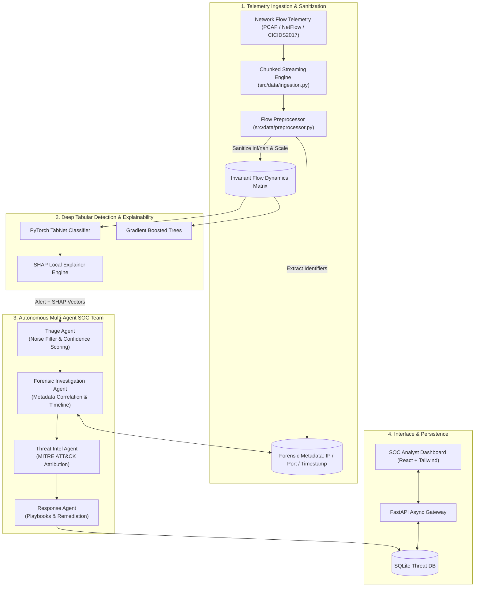

# CyberSentinel: Autonomous Multi-Agent Cyber Threat Investigation and Detection System

[](https://www.python.org/)
[](https://pytorch.org/)
[](https://fastapi.tiangolo.com/)
[](LICENSE)

CyberSentinel is an autonomous, explainable multi-agent cyber threat detection, triage, and response platform. Built for high-volume enterprise network monitoring, CyberSentinel merges deep tabular learning (**PyTorch TabNet**), game-theoretic feature attribution (**SHAP**), and collaborative autonomous reasoning agents into an end-to-end security operations workflow.

---

## 🏛️ System Architecture



---

## 🚀 Key Innovations & Design Principles

1. **Strict Identifier & Topology Separation**:
   In traditional machine learning for network intrusion detection, models suffer from severe *shortcut learning* by memorizing attacker IP addresses, static port numbers, or capture timestamps. CyberSentinel strictly separates network metadata from the feature matrix `X`, forcing the model to learn genuine flow dynamics (packet length variance, inter-arrival time distributions, TCP flag sequencing).
2. **Infinite & Zero-Variance Sanitization**:
   Handles zero-duration division-by-zero artifacts (`Flow Bytes/s = Inf`) via median imputation and quantile bounding learned strictly from training folds.
3. **Reproducible Stratified Sampling**:
   Network attacks are heavily imbalanced (e.g., Heartbleed or Infiltration represent <0.1% of flows). CyberSentinel's stratified sampler enforces minimum sample floors for rare attack vectors to prevent representation collapse during development.
4. **Local Game-Theoretic Explainability**:
   Every alert carries top feature attributions computed via SHAP, translating opaque model predictions into human-auditable and agent-digestible forensic reasoning tokens.

---

## 📁 Repository Structure

```
CyberSentinel/
├── config/                  # Centralized configuration and structured logging
│   ├── settings.py          # Pydantic v2 application settings
│   └── logging_config.py    # Logging formatters and stream handlers
├── data/
│   ├── raw/                 # Raw datasets (e.g. CICIDS2017 CSV files)
│   ├── processed/           # Processed and cleaned datasets
│   ├── samples/             # Stratified development subsets (dev_sample.parquet)
│   └── metadata/            # Preprocessor joblib artifacts and feature schemas
├── docs/
│   ├── PROJECT_TRACKER.md   # Daily implementation roadmap and checklist
│   ├── RESEARCH_PROPOSAL.md # Technical specification & research proposal
│   └── ARCHITECTURE.md      # Multi-agent architectural patterns
├── reports/
│   └── figures/             # Correlation heatmaps, label distributions, EDA charts
├── src/
│   ├── agents/              # Multi-agent triage, investigation, and response agents
│   ├── api/                 # FastAPI REST application and endpoint schemas
│   ├── core/                # SQLite database connection and SQLAlchemy models
│   ├── data/                # Ingestion, preprocessor, sampler, and schema definitions
│   ├── models/              # PyTorch TabNet and baseline detection architectures
│   ├── explainability/      # SHAP local attribution engine
│   └── utils/               # Statistical utilities and metrics helpers
├── tests/                   # Automated unit and integration test suite
├── requirements.txt         # Core dependencies (PyTorch CPU, TabNet, SHAP, FastAPI)
└── README.md                # Project documentation
```

---

## 🛠️ Quickstart Installation

### 1. Prerequisites
- Windows 11 (or Linux/macOS)
- Python 3.11 or 3.12
- Git

### 2. Environment Setup
```powershell
# Clone repository
git clone <repo-url> CyberSentinel
cd CyberSentinel

# Create and activate virtual environment
python -m venv venv
.\venv\Scripts\Activate.ps1

# Install CPU-optimized dependencies
pip install -r requirements.txt
```

---

## 📊 Dataset Ingestion: CICIDS2017

CyberSentinel uses the benchmark **CICIDS2017 (MachineLearningCSV)** dataset from the Canadian Institute for Cybersecurity (UNB).

### Automatic Download
```powershell
python -m src.data.downloader
```

### Manual Import Instructions
If automated direct download is blocked by the academic portal or captcha:
1. Navigate to: [UNB CICIDS2017 Dataset Page](https://www.unb.ca/cic/datasets/ids-2017.html)
2. Download `MachineLearningCSV.zip` (~223 MB).
3. Extract the 8 CSV files into `data/raw/` or `data/raw/MachineLearningCSV/`.
4. Run the ingestion and preprocessing pipeline:
```powershell
python -m src.data.ingestion
```

---

## 🧪 Running Automated Tests

```powershell
# Run the complete test suite
.\venv\Scripts\pytest.exe -v tests/
```

---

## 📋 Project Roadmap

- [x] **Day 1**: Foundation, chunked data pipelines, reproducible sampling, dataset profiling, automated tests.
- [ ] **Day 2**: Deep Tabular Detection Model (PyTorch TabNet) & Tree Ensemble Baselines.
- [ ] **Day 3**: Real-Time Local Model Explainability Engine (SHAP).
- [ ] **Day 4**: Autonomous Multi-Agent Threat Triage & Investigation Framework.
- [ ] **Day 5**: FastAPI High-Concurrency Telemetry Gateway & SQLite Event Engine.
- [ ] **Day 6**: React + Tailwind CSS Real-Time SOC Analyst Dashboard.
- [ ] **Day 7**: End-to-End System Evaluation, MITRE ATT&CK Mapping & Hardening.

---

## 📄 License
This project is licensed under the MIT License - see the LICENSE file for details.
