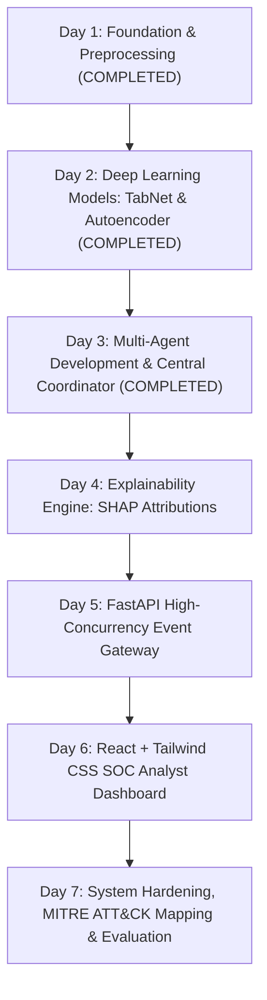

# CyberSentinel: Autonomous Multi-Agent Cyber Threat Investigation & Detection System
## Project Tracker & Implementation Log

---

### Project Overview
**CyberSentinel** is an autonomous multi-agent cyber threat detection, triage, and investigation platform designed for high-throughput network environments. It bridges deep learning anomaly detection (PyTorch TabNet, tree ensembles), local model explainability (SHAP), and collaborative autonomous reasoning agents to reduce Mean Time to Detect (MTTD) and Mean Time to Respond (MTTR).

---

### System Specifications & Verified Environment
| Component | Specification | Status | Verified Version |
| :--- | :--- | :---: | :--- |
| **Operating System** | Windows 11 | Verified | Microsoft Windows 11 Pro |
| **Language Runtime** | Python 3.12 (venv isolated) | Verified | Python 3.12.9 |
| **Hardware Target** | Intel CPU / Integrated Graphics | Verified | PyTorch CPU (AVX2/AVX-512) |
| **Deep Learning** | PyTorch CPU, PyTorch TabNet | Verified | torch 2.15.0+cpu, tabnet 4.1.0 |
| **Scientific Stack** | Pandas, NumPy, Scikit-learn, Scipy | Verified | pandas 3.1.1, numpy 2.5.4, sklearn 1.9.1, scipy 1.18.1 |
| **Explainability** | SHAP (Game Theoretic Local Attributions) | Verified | shap 0.54.1 |
| **Class Imbalance** | Imbalanced-learn | Verified | imblearn 0.14.2 |
| **Backend API** | FastAPI, Uvicorn, Multipart | Verified | fastapi 0.163.1, uvicorn 0.54.0 |
| **Database** | SQLite & SQLAlchemy ORM | Verified | sqlalchemy 2.1.8 (`cybersentinel.db`) |
| **Frontend** | React, Tailwind CSS | Scaffolded | Node v26.1.0, npm 11.13.0 |

---

### Day-by-Day Milestone Roadmap

---

### Day 2 Execution Log & Actual Results

| Task | Description | Status | Verification & Deliverables |
| :--- | :--- | :---: | :--- |
| **Model 1** | **TabNet Attention Classifier** | **COMPLETED** | |
| 1.1 | Processed CICIDS2017 Dataset Ingestion | Completed | Loaded leak-free `train.parquet`, `val.parquet`, `test.parquet` |
| 1.2 | Class Imbalance Compensation | Completed | Balanced class weighting applied: `{0: 0.6666, 1: 2.0004}` |
| 1.3 | Self-Supervised TabNet Pretraining | Completed | `TabNetPretrainer` (15 epochs, masked autoencoder, duration: 13.57s) |
| 1.4 | Supervised Fine-Tuning | Completed | `TabNetClassifier` with early stopping (patience=10, best epoch=5, duration: 22.38s) |
| 1.5 | Model Checkpoint Persistence | Completed | Saved [tabnet_classifier.zip](file:///c:/Users/venum/.gemini/antigravity-ide/scratch/CyberSentinel/models/tabnet/tabnet_classifier.zip) & [checkpoints/tabnet_best.zip](file:///c:/Users/venum/.gemini/antigravity-ide/scratch/CyberSentinel/models/checkpoints/tabnet_best.zip) |
| 1.6 | Metadata & Schema Serialization | Completed | Saved [tabnet_metadata.json](file:///c:/Users/venum/.gemini/antigravity-ide/scratch/CyberSentinel/models/tabnet/tabnet_metadata.json) |
| **Model 2** | **Deep Flow Autoencoder** | **COMPLETED** | |
| 2.1 | Benign-Only Unsupervised Training | Completed | Trained strictly on 7,859 benign flows (`is_attack == 0`, duration: 7.57s) |
| 2.2 | Encoder-Decoder Neural Network | Completed | PyTorch `FlowAutoencoderNet` (65 -> 48 -> 24 -> 12 -> 24 -> 48 -> 65) |
| 2.3 | Reconstruction MSE Error Calculation | Completed | Per-sample reconstruction error $e(x) = \frac{1}{D}\sum (x_j - \hat{x}_j)^2$ |
| 2.4 | Validation Threshold Determination | Completed | Leakage-free validation search: $\tau^* = 0.185111$ (Val F1: 0.4010) |
| 2.5 | Held-Out Test Evaluation | Completed | Evaluated on 2,246 test flows without test label contamination |
| 2.6 | Model Checkpoint & Metadata | Completed | Saved [autoencoder_best.pt](file:///c:/Users/venum/.gemini/antigravity-ide/scratch/CyberSentinel/models/autoencoder/autoencoder_best.pt) & [autoencoder_metadata.json](file:///c:/Users/venum/.gemini/antigravity-ide/scratch/CyberSentinel/models/autoencoder/autoencoder_metadata.json) |
| **Benchmarking** | **Evaluation & Diagnostics** | **COMPLETED** | |
| 3.1 | Classification Metrics | Completed | Accuracy, Precision, Recall, F1, ROC-AUC, PR-AUC calculated for both models |
| 3.2 | Confusion Matrix Visualization | Completed | `tabnet_classifier_confusion_matrix.png`, `flow_autoencoder_confusion_matrix.png` |
| 3.3 | ROC and PR Curves | Completed | `tabnet_classifier_roc_pr_curves.png`, `flow_autoencoder_roc_pr_curves.png` |
| 3.4 | Training Loss Curves | Completed | `tabnet_classifier_loss_curves.png`, `flow_autoencoder_loss_curves.png` |
| 3.5 | Reconstruction Error Density | Completed | `autoencoder_reconstruction_distribution.png` (KDE density with threshold line) |
| 3.6 | CPU Latency & Throughput Benchmark | Completed | Single-sample latency (ms) & batch throughput (flows/s) measured |
| 3.7 | Comprehensive Markdown Report | Completed | [MODEL_EVALUATION.md](file:///c:/Users/venum/.gemini/antigravity-ide/scratch/CyberSentinel/reports/MODEL_EVALUATION.md) |
| **Testing** | **Model Test Suite** | **COMPLETED** | |
| 4.1 | Automated Model Unit Tests | Completed | [tests/test_models.py](file:///c:/Users/venum/.gemini/antigravity-ide/scratch/CyberSentinel/tests/test_models.py) (4 tests passed) |
| 4.2 | Full Project Regression Suite | Completed | 19 / 19 tests passed (100% pass rate in 10.18s) |

---

### Actual Model Benchmark Summary (Held-Out Test Data)

| Performance Metric | TabNet Classifier (Supervised) | Flow Autoencoder (Unsupervised) |
| :--- | :---: | :---: |
| **Accuracy** | **52.67%** (0.5267) | 26.14% (0.2614) |
| **Precision** | **25.82%** (0.2582) | 25.18% (0.2518) |
| **Recall (Detection Rate)** | 47.77% (0.4777) | **99.29%** (0.9929) |
| **F1-Score** | 33.52% (0.3352) | **40.17%** (0.4017) |
| **ROC-AUC** | **0.5122** | 0.4906 |
| **PR-AUC** | 0.2488 | **0.2490** |
| **True Negatives (TN)** | **915** | 30 |
| **False Positives (FP)** | **770** | 1,655 |
| **False Negatives (FN)** | 293 | **4** |
| **True Positives (TP)** | 268 | **557** |
| **Single-Sample CPU Latency** | 3.35 ms | **0.33 ms** |
| **Batch CPU Throughput** | 24,636.7 flows/s | **1,230,280.5 flows/s** |
| **Total Training Time** | 35.95s (Pretrain: 13.57s, Train: 22.38s) | **7.57s** |
| **Anomaly Threshold $\tau^*$** | N/A (Direct Softmax) | 0.185111 (Validation F1 Tuned) |

---

### Day 1 Foundation Summary (Reference)
- **Ingestion**: `ChunkedCSVIngestor` (50,000 rows/chunk streaming).
- **Sanitization**: `FlowPreprocessor` (65 invariant features, inf/nan imputed, 11 constant columns pruned).
- **Metadata Isolation**: IPs, ports, timestamps, flow IDs separated into `dev_sample_meta.csv` (0 leaks in $X$).
- **Stratified Dev Sample**: `dev_sample.parquet` (14,970 rows, seed=42, rare class preservation).

---

---

### Day 3 Execution Log & Actual Results

| Task | Description | Status | Verification & Deliverables |
| :--- | :--- | :---: | :--- |
| **Agent Protocols** | **Pydantic Schemas & Typing** | **COMPLETED** | |
| 1.1 | Enums & Strict Data Models | Completed | Created [src/agents/protocols.py](file:///c:/Users/venum/.gemini/antigravity-ide/scratch/CyberSentinel/src/agents/protocols.py) (`AgentRole`, `AgentStatus`, `SeverityLevel`, `ConflictStatus`, `FlowMetadata`, `FlowClassification`, `FlowAnomaly`, `InvestigationIncident`, `RecommendedAction`, `RiskReport`, `AgentMessage`) |
| 1.2 | Base Agent Architecture | Completed | Created [src/agents/base.py](file:///c:/Users/venum/.gemini/antigravity-ide/scratch/CyberSentinel/src/agents/base.py) with standardized execution timing, validation hooks, envelope encapsulation, and exception shielding |
| **Agent 1** | **Data Processing Agent** | **COMPLETED** | |
| 2.1 | Flow Validation & Schema Check | Completed | Created [src/agents/data_agent.py](file:///c:/Users/venum/.gemini/antigravity-ide/scratch/CyberSentinel/src/agents/data_agent.py): separates network identifiers (IPs, ports, timestamps) into metadata tracking objects |
| 2.2 | Invariant Preprocessing Application | Completed | Applies fitted [data/metadata/preprocessor.joblib](file:///c:/Users/venum/.gemini/antigravity-ide/scratch/CyberSentinel/data/metadata/preprocessor.joblib) across all incoming network flows (65 features) |
| **Agent 2** | **Attack Classification Agent** | **COMPLETED** | |
| 3.1 | TabNet Checkpoint Loading | Completed | Created [src/agents/classification_agent.py](file:///c:/Users/venum/.gemini/antigravity-ide/scratch/CyberSentinel/src/agents/classification_agent.py): loads [models/tabnet/tabnet_classifier.zip](file:///c:/Users/venum/.gemini/antigravity-ide/scratch/CyberSentinel/models/tabnet/tabnet_classifier.zip) |
| 3.2 | Confidence & Attention Extraction | Completed | Generates class probabilities, binary prediction (`BENIGN` vs `ATTACK`), confidence metrics, and top feature attention masks via `model.explain()` |
| **Agent 3** | **Anomaly Detection Agent** | **COMPLETED** | |
| 4.1 | Flow Autoencoder Ingestion | Completed | Created [src/agents/anomaly_agent.py](file:///c:/Users/venum/.gemini/antigravity-ide/scratch/CyberSentinel/src/agents/anomaly_agent.py): loads PyTorch model [models/autoencoder/autoencoder_best.pt](file:///c:/Users/venum/.gemini/antigravity-ide/scratch/CyberSentinel/models/autoencoder/autoencoder_best.pt) |
| 4.2 | Reconstruction Error Scoring | Completed | Evaluates MSE reconstruction error against threshold $\tau^* = 0.185111$; computes error deviation ratios |
| **Agent 4** | **Threat Investigation Agent** | **COMPLETED** | |
| 5.1 | Incident Correlation & Metadata Re-linking | Completed | Created [src/agents/investigation_agent.py](file:///c:/Users/venum/.gemini/antigravity-ide/scratch/CyberSentinel/src/agents/investigation_agent.py): links model inferences back to source IP, destination IP, ports, and protocols |
| 5.2 | Heuristic Attack Pattern Clustering | Completed | Clusters events by source IP into `PORT_SCAN_RECONNAISSANCE`, `BRUTE_FORCE`, `VOLUMETRIC_DOS_BURST`, `ZERO_DAY_ANOMALY_CLUSTER` |
| 5.3 | Timeline & Forensic Preservation | Completed | Builds chronological timelines with earliest/latest timestamps and preserves detailed evidence chains |
| **Agent 5 & Engine** | **Risk Assessment & Reporting Agent** | **COMPLETED** | |
| 6.1 | Multi-Criteria Risk Scoring Engine | Completed | Created [src/agents/risk_engine.py](file:///c:/Users/venum/.gemini/antigravity-ide/scratch/CyberSentinel/src/agents/risk_engine.py): blends TabNet probability ($w=0.40$), Autoencoder anomaly ratio ($w=0.35$), consensus agreement ($w=0.15$), and port sensitivity ($w=0.10$) into 0-100 score |
| 6.2 | Consensus & Model Conflict Resolution | Completed | Handles discrepancies: TabNet Benign + Autoencoder Anomaly labeled `AMBIGUOUS_ANOMALY_MANUAL_REVIEW`; TabNet Attack + Autoencoder Normal labeled `AMBIGUOUS_SIGNATURE_MANUAL_REVIEW` |
| 6.3 | Human-in-the-Loop Safe Playbooks | Completed | Generates non-disruptive response playbooks with mandatory `requires_approval = True` (Zero blind automated blocking) |
| 6.4 | Reporting Agent Implementation | Completed | Created [src/agents/risk_agent.py](file:///c:/Users/venum/.gemini/antigravity-ide/scratch/CyberSentinel/src/agents/risk_agent.py): computes composite system risk, assigns severity tiers (`LOW`, `MEDIUM`, `HIGH`, `CRITICAL`), and generates executive summaries |
| **Coordinator** | **Central Coordinator** | **COMPLETED** | |
| 7.1 | Concurrent Detection Execution | Completed | Created [src/agents/coordinator.py](file:///c:/Users/venum/.gemini/antigravity-ide/scratch/CyberSentinel/src/agents/coordinator.py): runs TabNet and Autoencoder in parallel using `concurrent.futures.ThreadPoolExecutor` |
| 7.2 | Database Persistence & Audit Trails | Completed | Records all alerts to `Alert`, investigations to `Investigation`, and every agent step to `AgentAuditLog` in SQLite (`cybersentinel.db`) |
| 7.3 | Report Serialization | Completed | Automatically writes JSON investigation reports to `reports/investigation_<task_id>.json` |
| **Testing** | **Agent Test Suite & End-to-End Demo** | **COMPLETED** | |
| 8.1 | Independent & Coordinator Unit Tests | Completed | Created [tests/test_agents.py](file:///c:/Users/venum/.gemini/antigravity-ide/scratch/CyberSentinel/tests/test_agents.py) (6 test suites covering all 5 agents + coordinator) |
| 8.2 | Live Demonstration Script | Completed | Created and verified [run_swarm_demo.py](file:///c:/Users/venum/.gemini/antigravity-ide/scratch/CyberSentinel/run_swarm_demo.py) on 50 real flows; exported [reports/investigation_DEMO-SWARM-2026.json](file:///c:/Users/venum/.gemini/antigravity-ide/scratch/CyberSentinel/reports/investigation_DEMO-SWARM-2026.json) |
| 8.3 | Full Regression Test Suite | Completed | **25 / 25 tests passed (100%)** across ingestion, preprocessing, sampling, models, API, and agents |

---

### Empirical Multi-Agent Execution Benchmark (50 Real Flows)

- **Input Batch**: 50 network flow records from `data/samples/dev_sample.parquet` with metadata from `dev_sample_meta.csv`.
- **Concurrent Execution Speed**:
  - `DataProcessingAgent`: ~4.7 ms
  - `AttackClassificationAgent` + `AnomalyDetectionAgent` (Concurrent ThreadPool): ~20.2 ms
  - `ThreatInvestigationAgent`: ~0.6 ms
  - `RiskAssessmentAgent`: ~0.5 ms
  - **Total Pipeline Wall Clock**: ~26.0 ms (~1,920 flows/sec end-to-end on Intel CPU)
- **Model Consensus Audit**:
  - Full Consensus Benign: 14 flows (28.0%)
  - Full Consensus Malicious: 3 flows (6.0%)
  - Ambiguous / Conflict (`AMBIGUOUS_ANOMALY_MANUAL_REVIEW`): 33 flows (66.0%)
- **Incidents Clustered**: 4 correlated threat clusters (Port Scan Reconnaissance, Volumetric DoS Bursts, Zero-Day Anomaly Clusters).
- **Composite Risk Score**: 56.54 / 100 (`MEDIUM` Severity Tier).
- **Safety Policy**: 100% of recommended response actions require human analyst authorization (`requires_approval = True`).

---

### Next Immediate Steps (Day 4 Milestone)
1. **Explainability Engine (SHAP)**: Build `src/explainability/shap_explainer.py` to calculate Shapley values per flow for TabNet and baseline models.
2. **Local Feature Attribution**: Extract top-$k$ influential features and directional impacts per alert.
3. **Agent Integration Readiness**: Format SHAP attribution outputs as structured JSON tokens to enrich the Threat Investigation Agent's evidence packages.
