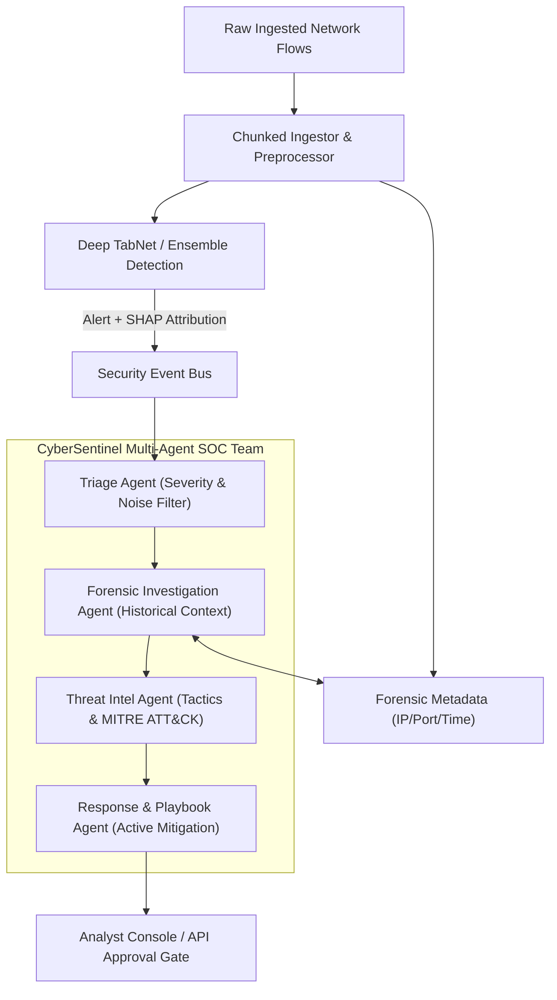

# CyberSentinel: Autonomous Multi-Agent Cyber Threat Investigation, Telemetry Attribution, and Active Mitigation
## Comprehensive Research Proposal & Technical Specification

**Author / Lead Researcher**: Senior Cybersecurity AI Researcher & Systems Architect  
**Project Codename**: CyberSentinel  
**Version**: 1.0.0 (Day 1 Working Draft)  
**Target Architecture**: PyTorch CPU / Intel x86_64 / FastAPI / React / SQLite  

---

## 1. Executive Summary

Modern Security Operations Centers (SOCs) face an existential volume problem: enterprise networks generate billions of raw packets and hundreds of thousands of flow alerts daily, leading to acute **alert fatigue**, missed indicators of compromise (IoCs), and prolonged Mean Time to Detect (MTTD) and Mean Time to Respond (MTTR). Traditional signature-based intrusion detection systems (IDS) fail against zero-day exploits, while conventional machine learning classifiers produce opaque binary flags without actionable forensic provenance or contextual justification.

**CyberSentinel** introduces an autonomous, multi-agent cyber threat investigation and detection platform that couples:
1. **Topologically-Invariant Network Feature Preprocessing**: Eliminating shortcut learning (IP/port/timestamp bias) from flow statistics.
2. **Interpretable Deep Tabular Anomaly Detection**: Utilizing attention-based neural architectures (PyTorch TabNet) combined with gradient-boosted ensembles to detect both volumetric and low-and-slow attacks.
3. **Local Forensic Attribution via SHAP**: Computing Shapley values per flow to explain *why* an alert fired at the packet feature level.
4. **Autonomous Collaborative Agent Triage**: Deploying specialized autonomous software agents (Triage, Forensics/Investigation, Threat Intel, and Response) that deliberate, correlate multi-source evidence, query historical baselines, and propose verified countermeasure playbooks.

---

## 2. Research Problem & Theoretical Motivation

### 2.1 The "Shortcut Learning" Pathology in Network Intrusion Detection
Numerous academic and commercial ML-NIDS systems report >99.9% accuracy on benchmark datasets such as KDD99, NSL-KDD, and CICIDS2017. However, empirical audits reveal that models frequently latch onto trivial artifacts:
- **IP Address Memorization**: Attacker IPs in testbeds are fixed (e.g., `192.168.10.50`), causing models to classify any flow from that IP as malicious regardless of payload dynamics.
- **Port Artifacts**: Port numbers associated with targeted services (e.g., port 21, 22, 80) cause the model to flag normal administrative traffic as an attack.
- **Temporal Clustering**: Consecutive flows collected during attack injection windows share timestamp proximity.

**CyberSentinel Solution**: We enforce strict schema isolation. Flow identifiers (Source IP, Destination IP, Source Port, Destination Port, Timestamp, Flow ID) are bifurcated from the feature matrix into an isolated forensic metadata store. Detection models are trained strictly on invariant statistical flow dynamics (inter-arrival times, packet length distributions, segment sizes, TCP flag transitions, window sizes).

### 2.2 Explainability Deficit in Autonomous Defense
Security analysts cannot act on an opaque probability score (e.g. `p(attack) = 0.942`). To authorize isolation, null-routing, or firewall rule reconfiguration, human analysts need causal attribution: Which packet length anomaly triggered the threshold? Was there an asymmetric SYN/ACK ratio indicating SYN-flood exhaustion?

**CyberSentinel Solution**: Every generated alert is paired with an automated SHAP attribution breakdown that surfaces the top contributing features and directional impact, serving as input tokens to autonomous investigation agents.

---

## 3. Multi-Agent System Architecture

CyberSentinel organizes cybersecurity defense into specialized autonomous agents communicating through an asynchronous event bus and shared working memory:

### Agent Roles:
1. **Triage Agent**: Filters false positives, calculates alert confidence, deduplicates repetitive volumetric bursts, and assigns priority tiers (Low, Medium, High, Critical).
2. **Forensic Investigation Agent**: Re-links the behavioral flow anomaly to the isolated network metadata (source IP, subnet, host role), correlates concurrent flows across the time window, and reconstructs the attack timeline.
3. **Threat Intelligence Agent**: Maps observed behavioral signatures and SHAP feature attributions to MITRE ATT&CK tactics (e.g., T1046 Network Service Scanning, T1498 Network DoS, T1110 Brute Force).
4. **Mitigation & Playbook Agent**: Synthesizes structured remediation proposals (iptables rules, BGP blackholing, rate-limiting, host isolation) and drafts incident reports for human sign-off.

---

## 4. Dataset & Preprocessing Methodology

### 4.1 Dataset Benchmark: CICIDS2017
CyberSentinel leverages the **CICIDS2017** benchmark from the Canadian Institute for Cybersecurity (University of New Brunswick).
- **Benign Baseline**: Monday working hours traffic capture.
- **Attack Taxonomies**:
  - *Brute Force*: FTP-Patator, SSH-Patator (Tuesday)
  - *Denial of Service (DoS)*: Slowloris, SlowHTTPTest, Hulk, GoldenEye, Heartbleed (Wednesday)
  - *Web Attacks*: SQL Injection, Cross-Site Scripting (XSS), Brute Force (Thursday Morning)
  - *Infiltration*: Dropbox exploit and lateral privilege escalation (Thursday Afternoon)
  - *Botnet*: Ares botnet command and control (Friday Morning)
  - *Port Scanning & DDoS*: Network sweeps and LOIC DDoS (Friday Afternoon)

### 4.2 Preprocessing Rigor
- **Chunked Stream Processing**: Scalable ingestion via bounded memory iterators ($50,000$ records/chunk).
- **Infinite & Extreme Outlier Remediation**: Zero-duration flows producing division by zero (`Flow Bytes/s = Inf`) are clamped and imputed with median values learned exclusively from training sets.
- **Deduplication**: Elimination of capture replays and retransmissions.
- **Variance Thresholding**: Automatic elimination of static zero-variance telemetry.
- **Reproducible Stratified Sampling**: Preservation of rare attack classes with strict pseudo-random seeding ($S=42$).

---

## 5. Technology Stack & Operational Feasibility

| Layer | Selected Technology | Technical Justification |
| :--- | :--- | :--- |
| **Compute Execution** | PyTorch CPU (Intel AVX2/AVX-512) | Eliminates GPU dependency; lightweight deployment on standard cloud VMs or edge devices. |
| **Tabular Learning** | PyTorch TabNet & Tree Ensembles | Sequential attention masks provide inherent sparsity and interpretability on tabular flows. |
| **Explainability** | SHAP (TreeExplainer / KernelExplainer) | Game-theoretic, axiomatic local feature attribution for explainable AI. |
| **API & Backend** | FastAPI, Uvicorn, Pydantic v2 | High-concurrency asynchronous I/O, strict schema validation, and OpenAPI documentation. |
| **Data Persistence** | SQLite (SQLAlchemy 2.0 ORM) | Zero-configuration, transactional relational storage suited for rapid prototyping and local auditing. |
| **Interface** | React, Tailwind CSS | Real-time SOC visualization, interactive alert triage, and MITRE matrix visualization. |

---

## 6. Project Milestones & Verification Criteria

- **Phase 1 (Day 1 - Foundation)**: Workspace, dependency verification, chunked data pipelines, reproducible sampling, dataset profiling, and automated test suite.
- **Phase 2 (Day 2 - Detection Engines)**: Baseline and deep learning TabNet model training, validation, cross-validation, and metrics evaluation (Precision, Recall, F1, AU-PRC).
- **Phase 3 (Day 3 - Explainability)**: Real-time SHAP explainer integration and feature attribution persistence.
- **Phase 4 (Day 4 - Multi-Agent Core)**: Autonomous agent orchestration, prompt templates, memory stores, and deliberation logic.
- **Phase 5 (Day 5 - API & Event Bus)**: REST endpoints for streaming telemetry ingestion, alert dispatch, and agent triggering.
- **Phase 6 (Day 6 - Frontend SOC Console)**: Real-time dashboard with alert feeds, agent thoughts/logs, and playbook approvals.
- **Phase 7 (Day 7 - Validation & Hardening)**: Full end-to-end integration testing, adversarial resilience checks, and final research report.
